<p align="center">
  
</p>

<p align="center"><strong>Curious about how things work. Even more curious about making them better.</strong></p>
<p align="center"><a href="https://github.com/devanshmishra865?tab=repositories">Explore the code</a> · <a href="https://github.com/devanshmishra865?tab=stars">Things that caught my attention</a></p>

## `whoami`

I'm **Devansh**, a Java full-stack and AI developer drawn to backend systems, useful interfaces, and agents that do more than just chat.

I want to contribute to **open source**: understand the code, ask better questions, and turn small fixes into something useful. Java, Spring Boot, React, and Python are the areas I'm focusing on.

## `/dev/interests`

`Java` `Spring Boot` `React` `Python` `AI agents` `Open source`

- **Systems:** following a request from the UI to the backend and back.
- **AI:** exploring how models, tools, and agent workflows fit together.
- **Open source:** finding projects where I can learn the codebase and contribute thoughtfully.

## `ls projects/`

| Project | What's inside |
| :--- | :--- |
| [Real-Time Chat](https://github.com/devanshmishra865/realTimeChat) | Java + Spring Boot chat with WebSocket/STOMP messaging, MySQL message storage, and a responsive Thymeleaf interface. |
| [University Club Management System](https://github.com/devanshmishra865/university-club-management-system) | A planned Spring Boot + React application for clubs, events, registrations, and attendance. **Planning stage.** |
| [Agentic Chatbot](https://github.com/devanshmishra865/Agentic-Chatbot) | A fork exploring LangGraph, Groq, Streamlit, and web-assisted conversations. |
| [DeleteMe Agent](https://github.com/devanshmishra865/DeleteMe-Agent--DPDPA-Data-Eraser) | A fork exploring Python multi-agent workflows and MCP for data-erasure requests. |

## `git checkout -b contribute`

I'm interested in **Java/Spring Boot projects, developer tools, and AI applications**. Small bug fixes, clearer docs, and well-scoped features are where I'd like to start.

Have a project in that space? I'd enjoy talking code and finding a useful way to help.

<details>
<summary><strong>🧪 Open the developer console</strong></summary>

```java
// The loop I'd like to keep running.
while (curious) {
    readTheCode();
    askBetterQuestions();
    buildSomethingUseful();
    shareWhatILearn();
}
```

<sub>Still investigating why the bug disappears when the debugger is attached.</sub>

</details>

---
<p align="center"><code>learn → build → debug → share → repeat</code></p>
